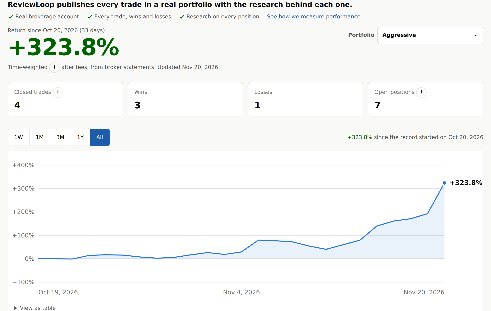

# Crypto Arbitrage

Updated on Nov 22, 2026:

Since this arbitrage bot, I have kept improving trading automation and market analysis, and extended what I learned here beyond crypto to US stocks and options as well. I have now started to publish the analysis and trades, wins and losses, on [ReviewLoop](https://reviewloop.dev/). The name comes from how it works: AI keeps reviewing the rules in a loop against historical and live market data, learns from the results and makes new rules on its own, and each new rule is reviewed before it goes into use. Every trade follows these rules. They are fundamental and technical, backtested on over 20 years of daily prices from more than 3,400 US stocks. The fundamental side is the Stock Health Score, which reads each company's financial numbers and filings. The technical side is the chart analysis. I have built AI Analyzer to bring both sides, with all their rules and data, together in one tool. In its first month, the portfolio is up +323.8%.

Most of it is free to read. Members see the live trades.

The original arbitrage bot is below if you want to look at the code.

---

## Introduction
This is an automatic trading bot using Triangular or Exchange Arbitrages. It reguarly checks and detects arbitrage opportunities, and place orders when a profit can be made. This works on any cryptocurrency pairs with minor configuration.  
Started with $1000 in October 2017, there were some times that this made about $40/day for a few weeks with Triangular Arbitrage on Bittrex, but as the market is getting very unstable, the profit is hard to outrun the high price fluctuation.

## Exchanges
Bittrex, Bitfinex, Bitstamp, Kraken, Gatecoin (Not maintained anymore due to its extremely low volume)

## Setup
1. Install Python 2 at here https://www.python.org/downloads/ if necessary. **This bot will not work with Python 3.**
2. `pip install grequests`
3. Rename or copy `.key_sample` files under `keys` to `.key` file, and add the APIs. E.g. Create a file `bittrex.key`. **Make sure not to push any API keys or this `.key` file.**
4. Modify `arbitrage_config.json` for any other ticker pairs or exchanges

## Usage
Triangular: `python main.py -m triangular`  
Exchange:   `python main.py -m exchange`  
Mock mode is enabled by default, which does not place any order and just check and show any arbitrage opportunities. To turn off mock mode and run in production, add the argument `-p`.

## Difficulties
1. The trading fee is the largest obstacle. Most of the exchanges have a 0.25% fee. The profit will be larger if the fee can be lower.
2. Sometimes not all the placed orders are executed, so there will be some manual work to rebalance. The bot should be able to deal with this situation, such as placing a market order, instead of just cancelling the open orders.

## Further Improvement
1. Implement exchange rebalancing
2. Handle open orders strategically
3. Refactoring  

I will put this project on hold now as the price goes up and down so much. Hope this can help anyone with similar interests.
